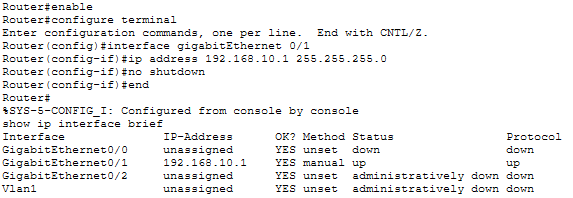
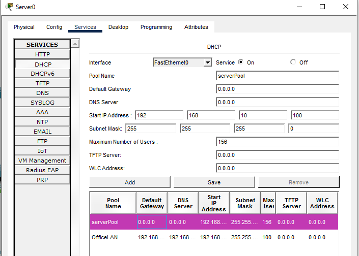
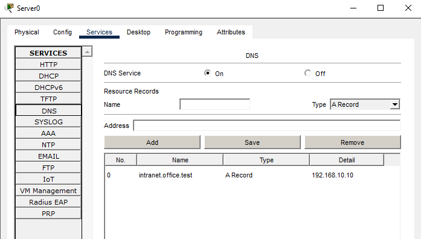
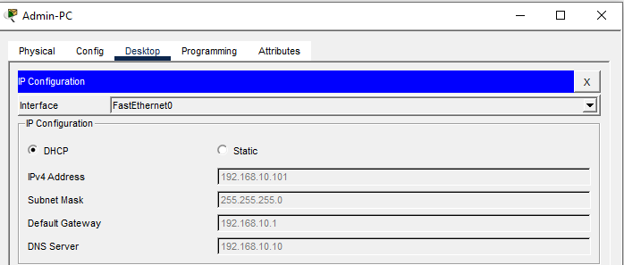
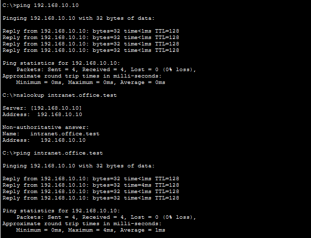

# Small Business Network Lab

## Overview
Built a small office network in Cisco Packet Tracer for three departments: Administration, Finance, and IT. The lab uses one Cisco 2911 router, one Cisco 2960 switch, three workstations, and one server providing DHCP and DNS.

## Goals
- Establish Layer 1/2 connectivity and enable the correct router interface.
- Configure IPv4 addressing and a default gateway.
- Deploy DHCP to automatically configure client workstations.
- Configure internal DNS and verify name resolution.
- Test network connectivity and document troubleshooting.

## Topology
- Router0 (Cisco 2911), GigabitEthernet0/1 -> Switch0 (Cisco 2960)
- Switch0 -> Admin-PC, Finance-PC, IT-PC, Server0
- All devices share a single LAN (`192.168.10.0/24`). Department names do not represent separate VLANs.

## Addressing plan
| Device | Address | Assignment |
| --- | --- | --- |
| Router0 G0/1 | `192.168.10.1/24` | Static |
| Server0 | `192.168.10.10/24` | Static |
| Admin-PC | `192.168.10.100–199/24` | DHCP |
| Finance-PC | `192.168.10.100–199/24` | DHCP |
| IT-PC | `192.168.10.100–199/24` | DHCP |

Default gateway: `192.168.10.1`  
DNS server: `192.168.10.10`

## DHCP
- Server: Server0
- Pool: `OfficeLAN`
- Start: `192.168.10.100`
- Maximum users: `100`
- Subnet mask: `255.255.255.0`
- Default gateway: `192.168.10.1`
- DNS server: `192.168.10.10`

## DNS
Configured an A record:

`intranet.office.test` -> `192.168.10.10`

## Validation
Reported results from lab testing:
- Admin-PC: IP configuration, gateway ping, server ping, and hostname ping passed.
- Finance-PC: IP configuration, gateway ping, server ping, and hostname ping passed.
- IT-PC: IP configuration, gateway ping, server ping, and hostname ping passed.
- Finance-PC DNS lookup resolved successfully.

**Final PC-to-PC connectivity test:** _Add actual IPs and results after testing._

## Troubleshooting lesson
The router-to-switch link initially stayed down because the enabled router interface (`GigabitEthernet0/0`) was not the port connected to the switch. The actual cable was connected to `GigabitEthernet0/1`. Enabling the correct interface using `no shutdown` restored the intended link. This reinforced the importance of checking physical port mappings before changing configurations.

## Evidence

## Network Topology

The network consists of a Cisco 2911 router, a Cisco 2960 switch, three workstations, and one server.

## Router Configuration

Configured GigabitEthernet0/1 with the IPv4 address 192.168.10.1/24.

## DHCP Configuration

Configured Server0 to automatically assign IP addresses to office workstations.

## DNS Configuration

Created an A record mapping intranet.office.test to 192.168.10.10.

## Connectivity Testing

Verified that workstations could reach the router and server and resolve the internal hostname.

  

## Files
- `small-business-network.pkt` — _Add the saved Cisco Packet Tracer file._

## Skills practiced
Cisco IOS CLI, IPv4 subnetting basics, switch connectivity, default gateways, DHCP, DNS, ICMP/ping, interface troubleshooting, and network documentation.

## Next step
Build department VLANs and inter-VLAN routing in Project 2.
